# MacroTrack

MacroTrack is a comprehensive macro and calorie tracking application built with **Kotlin Multiplatform** and **Compose Multiplatform**, targeting both Android and iOS. It helps users manage their nutrition goals, track daily intake, and monitor their weight progress.

## 📱 Screenshots

| Food log | Calendar & streak | Edit an entry | Add meal |
|:---:|:---:|:---:|:---:|
| 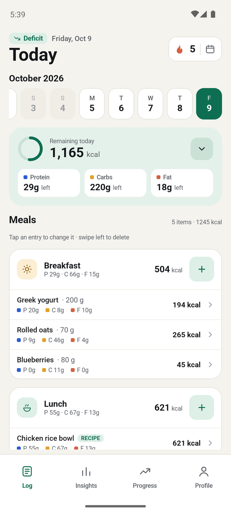 | 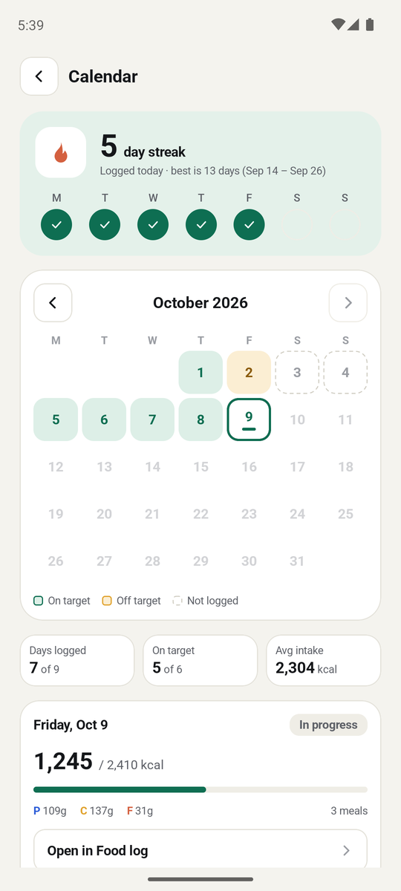 | 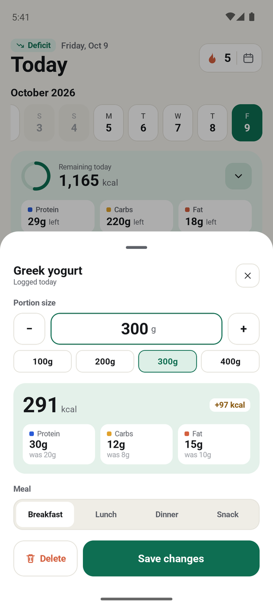 | 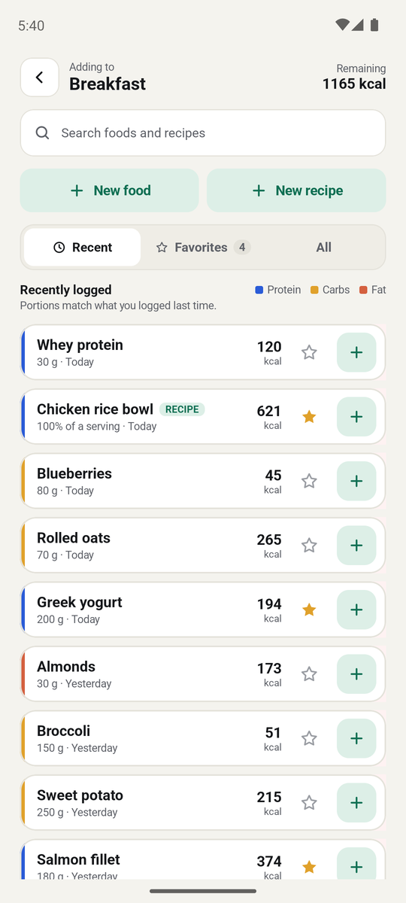 |

| Insights | Progress | Weight history | Profile |
|:---:|:---:|:---:|:---:|
| 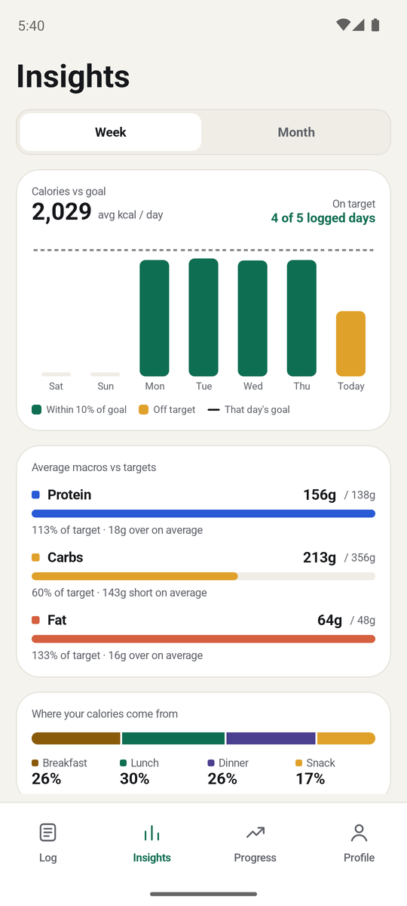 | 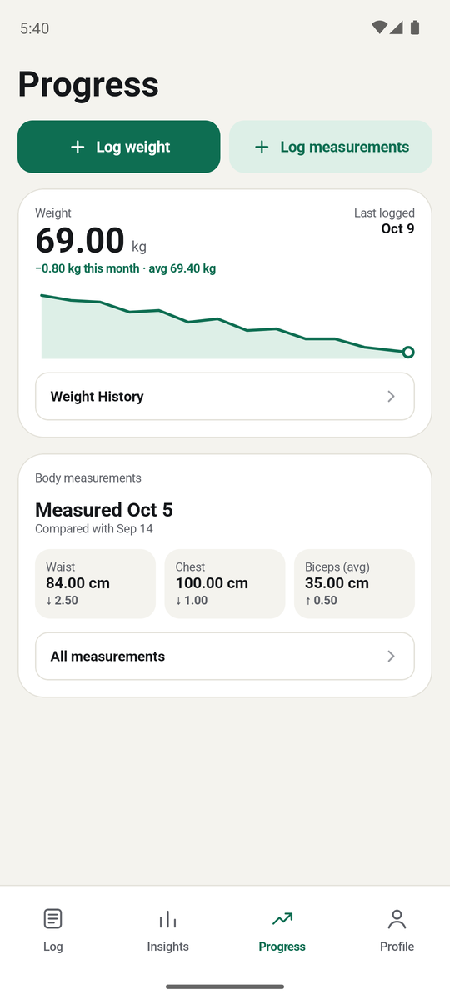 | 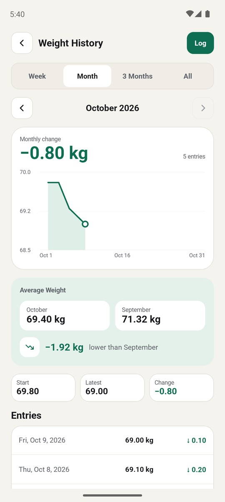 | 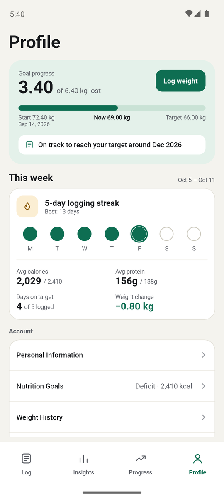 |

| Nutrition goals | Change a past goal | Food log (dark) | Calendar (dark) |
|:---:|:---:|:---:|:---:|
| 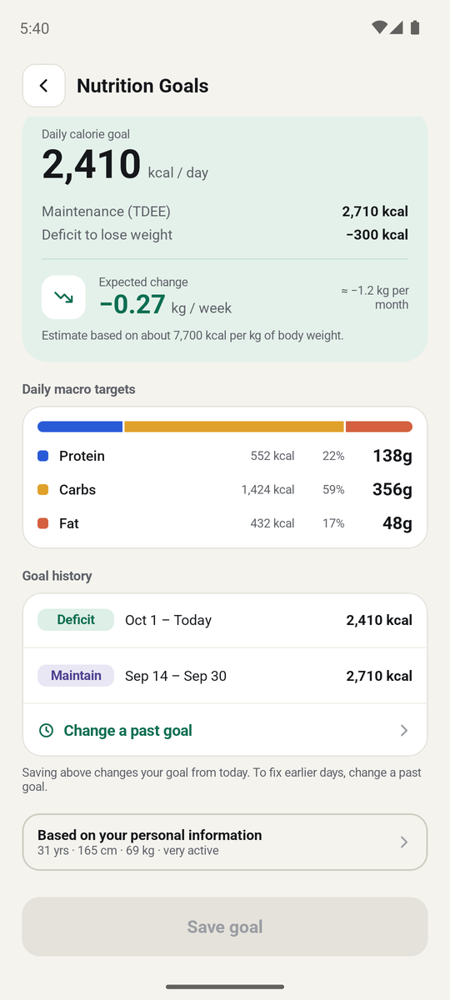 | 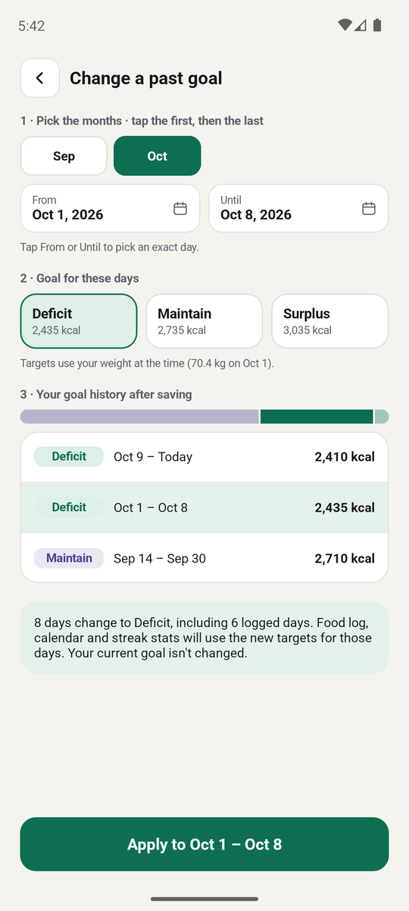 | 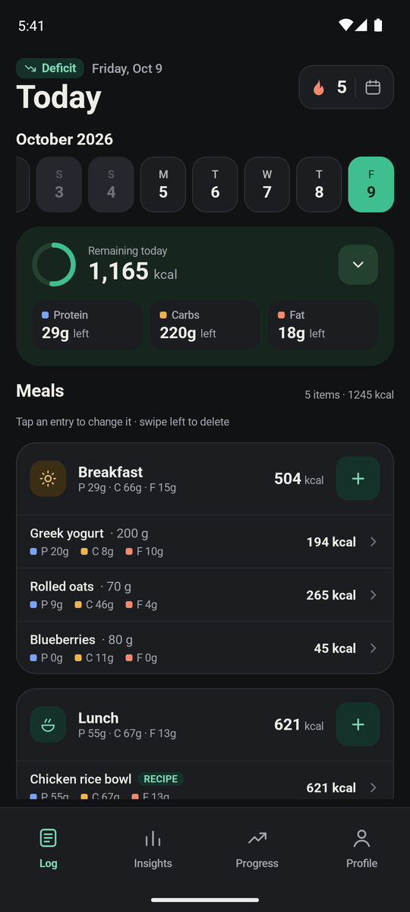 | 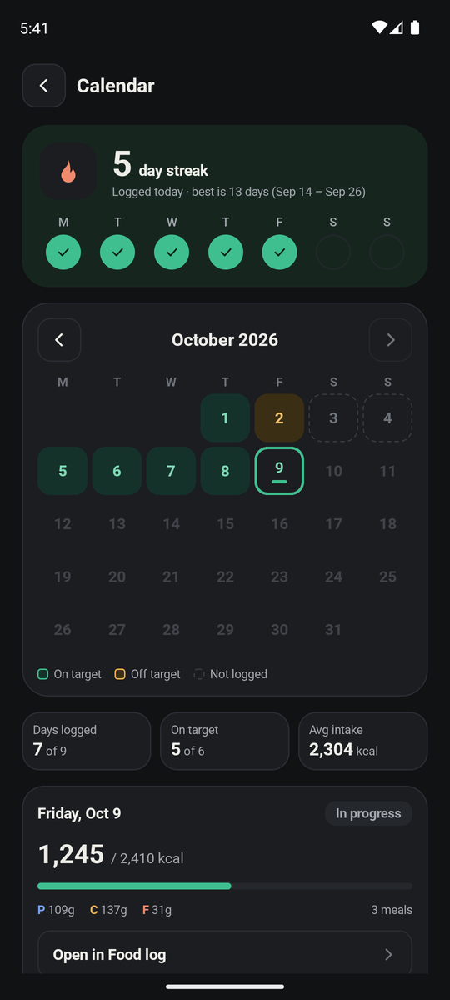 |

## 🚀 Features

- **Onboarding & Goal Setting**: Personalized setup including activity level, sex, and weight goals to calculate target macros and TDEE.
- **Daily Food Log**: Track calories, protein, carbs and fat per meal, and browse past days.
    - Tap any entry to change its portion or move it to another meal; swipe left to delete.
    - A logging streak in the header opens a calendar of on-target and off-target days with monthly stats.
- **Meal Management**:
    - Search foods and recipes within the Recent, Favorites or All tabs.
    - Recent remembers the portion you logged last time; star foods to keep them in Favorites.
    - Customize portions and weights for accurate tracking.
- **Custom Content Creation**:
    - Create your own food entries with detailed macro information.
    - Build recipes by combining multiple ingredients.
- **Nutrition Goals**:
    - Deficit, maintain or surplus targets calculated from your personal information.
    - A goal history that keeps past days judged against the goal they had, and lets you change the goal for a past date range.
- **Insights**: Weekly and monthly calories against your goal, average macros against targets, and where your calories come from.
- **Progress Tracking**:
    - Weight history by week, month, 3 months or all time, plus progress toward a target weight.
    - Body measurements with change over time.
- **Light & Dark Themes**: Follows the system setting on Android and iOS.
- **Offline Support**: Fully functional offline using a local database.

## 🛠 Tech Stack

- **Kotlin Multiplatform**: Shared business logic and UI across Android and iOS.
- **Compose Multiplatform**: Declarative UI framework for shared screens.
- **Room Database**: Local persistence for food logs, recipes, and user data.
- **Koin**: Lightweight dependency injection framework.
- **Navigation Compose**: Type-safe navigation for shared UI.
- **Kotlinx Serialization**: JSON parsing and serialization.
- **Kotlinx DateTime**: Handling date and time operations across platforms.

## 📂 Project Structure

- `composeApp/src/commonMain`: Shared Kotlin code including UI (Compose), ViewModels, Repositories, Use Cases, and Domain models.
- `composeApp/src/androidMain`: Android-specific implementations and entry point (`MainActivity`).
- `composeApp/src/iosMain`: iOS-specific implementations and entry point (`MainViewController`).
- `iosApp`: The Xcode project for the iOS application.

## 🛠 Getting Started

### Prerequisites

- Android Studio (latest version recommended)
- Xcode (for iOS development)
- JDK 11 or higher

### Build and Run

#### Android
You can run the app from Android Studio or via the terminal:
```bash
./gradlew :composeApp:assembleDebug
```

#### iOS
1. Open the `iosApp` directory in Xcode.
2. Select a simulator or physical device.
3. Build and Run (Cmd + R).

Alternatively, use the run configurations provided in Android Studio if the KMP plugin is installed.

---

*Developed with ❤️ using Kotlin Multiplatform.*
